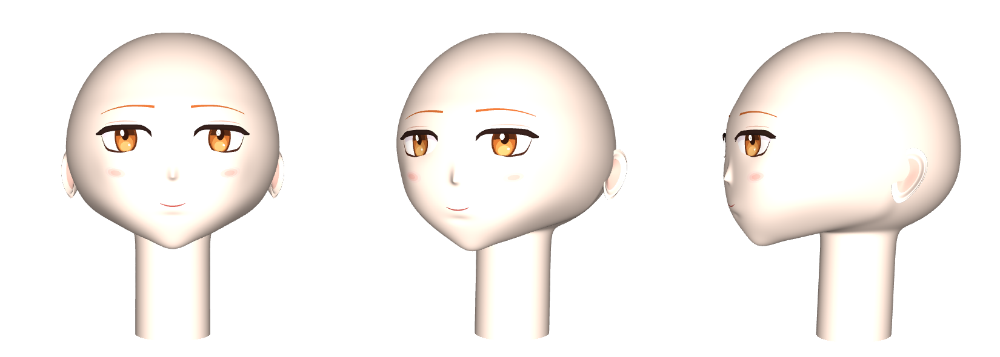
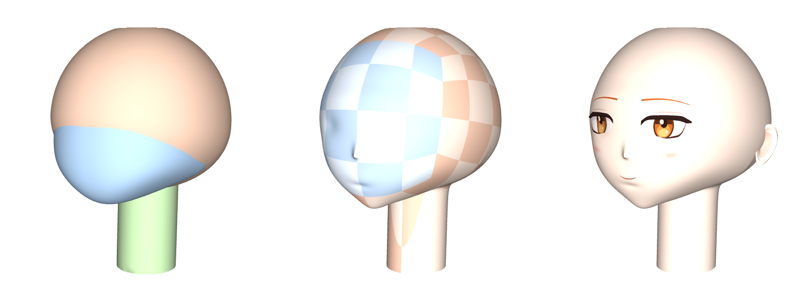
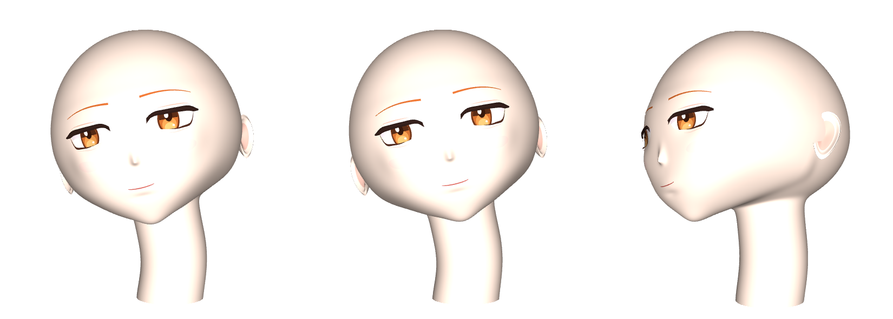

# Claude Chan's face, a 3D Arch figure

Claude Chan's face and head, from the orange-haired character sheet, built only from parametric surfaces. This model is a fresh start and shares nothing with `examples/claude-chan/`. It covers the face only: no hair and no outfit.



| File | |
|---|---|
| `claude-chan-face.txt` | The Arch save file of the base face. Open it with Arch's *Open file*. |
| `claude-chan-face.arch` | The scene script it was built from: 141 parametric surfaces and 11 functions. |
| `claude-chan-face-natural-smile.txt`, `.arch` | Expression 1 from the sheet, 自然微笑 (natural smile). See [Expressions](#expressions). |
| `generate.py` | Writes the scene scripts (needs numpy). |
| `construction.png`, `natural-smile.png` | The figures below. |

The file is saved with `implicitPrecision=20`, so every surface gets Arch's finest mesh (60 x 60 cells). Lower the *equation, inequality and parametric surface precision* setting in Arch for faster redraws while you rotate the head.

## How the face is modelled



*Left: the three primitives drawn separately. Middle: their soft union with the small forms added, drawn as a cube-sphere of tiles (front face blue). Right: the finished face.*

### One surface, seen from one centre

The skin of the head, face and neck is a single closed surface. It is star-shaped around the head centre, so it can be written as a radius along each direction:

```
P(D) = hr(D) * D          D = (p, q, w), any length; x forward, y her left, z up
```

`hr(p,q,w)` is one Arch function, defined once in the file. All 96 skin tiles call it, and so do the face's decals, with region-specific copies (see below).

### Primitives as reciprocal radii

Each primitive gives `1/s`, where `s*D` is the point where the ray along `D` leaves the primitive. Each one is written so that `1/s` is homogeneous of degree 1 in `D`, so `D` never needs normalising:

| Primitive | `1/s` along D | Used for |
|---|---|---|
| Superquadric centred on the head centre, with its own semi-axis in each direction (front, back, side, top, bottom), exponent `n` across and `m` up and down | `( ((p⁺/xf)ⁿ + (p⁻/xb)ⁿ + (\|q\|/y)ⁿ)^(m/n) + (w⁺/zt)ᵐ + (w⁻/zb)ᵐ )^(1/m)` | skull, lower face |
| Off-centre quadric (here a slanted cylinder) | `(sqrt(B² − A·C) − B) / (−C)`, with `A = DᵀMD`, `B = DᵀMc`, `C = cᵀMc − 1` | neck |
| Half-space `n·X ≤ h` | `max(n·D, 0) / h` | sides of the jaw, under the jaw, ends of the neck |

The superquadrics are what make the head read as anime rather than as a ball. The skull's horizontal sections are slightly square (`n = 2.15`), so the face is broad and flat across the eyes. The lower face is deep in front and long below (`zb = 0.91`, `m = 3.2`), so the front stays nearly vertical from the nose to the mouth before it turns into the chin.

### Soft union and intersection without repeating anything

Arch expands user functions as text macros. A smooth-min written the usual way, `min(a,b) − h(a,b)`, repeats its arguments, so nesting a few of them multiplies the formula size exponentially. A first test with three nested ones did not finish meshing 24 tiles within 30 seconds. Here every blend is instead a p-norm, in which each part appears once:

```
soft intersection   1/s^k = Σ 1/s_i^k        (k = 12: jaw;  k = 40: neck)
soft union            s^k = Σ s_i^k          (k = 24: skull + lower face;  k = 14: + neck)
```

Both stay homogeneous, so a blend is a fixed fraction of the head's size. A smaller `k` gives a wider, softer blend. The whole head is:

```
head = union₁₄( union₂₄( skull, inter₁₂(lower face, jaw left, jaw right, under the jaw) ),
                inter₄₀(neck cylinder, below z = 0.2, above z = −1.55) )
```

The soft intersection with the two jaw half-spaces gives the V of the jaw with a rounded chin. The half-space under the jaw makes the line from the chin back to the neck.

### Small forms as bumps

Eye sockets, nose, cheeks, lips, chin and the hollow under the lower lip multiply the radius by `exp(Σ amp·exp(−Q))`. Each `Q` is a Gaussian in the front-face coordinates `(u, v) = (q/p, w/p)`, the same plane the face is drawn in. Symmetric pairs (eye sockets, cheeks) use `|q|`, so one term makes both. The nose has a different falloff above (the bridge) and below (the underside), and a sharpened top (`Q^0.8`) for the small pointed anime nose.

Behind the head, `q/p` would map a tiny copy of every bump onto the point straight behind the face. It is invisible, but it disturbs Arch's finite-difference normals, which showed up as a dark speck. So `u` is pushed far away for `p < 0` with a `1000*max(-p,0)` term.

### Cube-sphere tiles

Arch meshes a parametric surface on at most 60 x 60 cells, so one surface for the whole head would be far too coarse. Instead the directions are those of a cube: `D = (1, u, v)` on the front face, `(−u, 1, v)` on her left face, and so on, with `u, v ∈ [−1, 1]`. Each of the six faces is cut into the same 4 x 4 grid of tiles, and each tile is one Arch surface. Because all six faces are cut the same way, tiles that meet across a cube edge sample their shared edge at the same points. An earlier mix of 5 x 5 and 3 x 3 grids left hairline cracks. The cube-sphere has no poles, and each face's `(u, v)` order gives an outward normal, which Arch lights at full strength.

### The face as decals in the front-face plane

On the front face, `(u, v)` is the front view divided by the depth, and the depth hardly changes across the face. That makes it a natural drawing plane, matching the character sheet's front view. Eyes, brows, blush and mouth are patches over regions of that plane, lying on the skin:

```
P = dX(U, V, L) * (1, U, V),   dX(a,b,c) = hX(a,b) * (1 + c)
```

- **Layers.** Each layer is lifted by its own multiple of 0.16 % of the radius (sclera 1, lid shadow 2, iris rim 3, … highlights 9, lash line 10). The layers therefore stack in a fixed order in Arch's single depth buffer, without flicker.
- **Strips.** The white of the eye, the lash line, the lower lash, the lid crease, the brows and the mouth are strips: `U = u₀ + width·s`, and `V` runs from a lower curve to an upper curve in `s`. The lid curves `lidu(s)` and `lidl(s)` are smooth polynomials fitted to a few control points, held exactly at their ends so that the two lids meet at both corners. Every layer of the eye uses the same two functions, so the layers line up exactly.
- **Clamped ellipses.** The iris layers (dark rim, amber body, two bright lower bands, the lid's shadow), the pupil and the highlights are ellipses in polar form. Their `V` is clamped between the two lids, `min(max(V, lidl), lidu)`. Points outside the eye collapse onto the lid line, so the iris is cut by the lids exactly, as in the drawing.
- **A raised lash line.** The upper lash band's lift grows across its width, `L = 0.016 + 0.01·sin(πw)`. The lash line is therefore a small ridge, not paint, and catches the light like the edge of an eyelid. A wing past the outer corner and a smaller flick below it are drawn the same way.
- **Shorter radius functions per region.** The decals of the eyes and brows (`he`), the cheeks (`hc`) and the mouth (`hm`) each get their own copy of `hr`, specialised to `p = 1`. Each copy leaves out every primitive and bump that changes the radius by less than 10⁻⁶ in that region; the generator checks that each copy still matches `hr` to within 2·10⁻⁵. This cut the meshing time of the decals several times over.

### Ears

The ears are separate shells. Each is a pear-shaped outline in its own frame on the side of the head, with a flare that lifts the back edge off the head, a rolled rim, and a hollow bowl with a slightly pinker inner surface. A second surface closes it from behind and sinks into the head.

## What is on the face

- Amber eyes shaped as on the sheet: a nearly straight upper lid with both corners up near it, and the eye hanging below it like a bowl. The iris has a dark brown rim, an amber-brown body, lighter lower bands, a dark top under the lid. The pupil sits high, just under the upper lid, with a small highlight beside it and a smaller one lower down, both on the viewer's left.
- A thick, dark, flat upper lash line. It starts thick at the inner corner with a short hook down into it, and ends in a short wing past the outer corner, pointing out and a little down. The lower lash line thickens toward the outer corner, where it meets the wing. There is also a soft lid crease.
- Thin, nearly straight orange eyebrows, a little thicker at the inner end.
- Soft three-step blush on the cheeks, a small pointed nose made by shape alone, and a small closed smile.
- A V-shaped jaw with a rounded chin, ears, and a slender neck.
- She looks up by 10°, measured from the sheet. In its portraits the nose sits 0.31 of the way from the eye line to the chin, and the mouth 0.59–0.63. With the head level, the model measured 0.40 and 0.64, which reads as looking down. Looking up 10° and a slightly higher nose give 0.335 and 0.60. The saved views are near eye level (2°).

## Expressions



Each expression on the character sheet is a set of changes to a few numbers of the face, kept in `EXPRESSIONS` in `generate.py`. The base face is `base`; `--expression NAME` writes `claude-chan-face-NAME.arch`. The surfaces stay the same; only their formulas change:

| Setting | What it changes |
|---|---|
| `lid_up`, `lid_lo` | Move the middle of the upper and lower lid curves (by `amount·sin(πt)^0.8`, so the corners stay). The white of the eye, the lash line, the crease and the clamps of the iris all follow, because they are all written with `lidu(s)` and `lidl(s)`. |
| `under_eye` | Adds the soft fold under the lower lid that a smile pushes up. |
| `gaze`, `converge`, `glow_dv` | Move both irises (where she looks), move each one toward the nose, and move the bright bands inside them. |
| `brow_dv` | Raises or lowers the eyebrows. |
| `mouth` | The mouth line: corner lift, an upturn at the very ends (`hook`), asymmetry, thickness and taper. |
| `cheek` | Height and size of the cheek bumps in `hr`, so the skin itself changes shape. |
| `blush_v`, `blush` | Height of the blush and how many of its three steps are drawn. |
| `tilt`, `pitch` | Head tilt toward her right and how far she looks up, in degrees (`pitch` is 10 for every expression). |
| `view` | The saved camera angle. |

**1. 自然微笑, natural smile** (`--expression natural-smile`). The upper lids relax down over the top of the iris and the lower lids rise, so the eyes are calm and heavy-lidded. A light fold shows under each eye. The irises sit a little toward the nose, more in her left eye, as on the sheet, so she looks at the viewer. The pupils show as dark spots just under the lids. The mouth is a nearly straight, slightly longer closed line whose ends turn up a little, her left end more. The cheeks are fuller and higher, with only a trace of blush. The head is tilted 12° toward her right as well as looking up, and the camera is a little to her left, as in the sheet's portrait.

The pose is cheap for the head. A rotation `R` (look up, then tilt) about a point at the top of the neck turns `t + R·(hr(D)·D)` into `t + hr(D)·(R·D)`, so only the direction factor changes. The look-up turns the neck with the head. For the tilt, the neck can't turn rigidly, or it would lean. So the tiles that reach into the neck use a tilt angle that grows smoothly with height, `θ(z) = θ·smoothstep(z)`, from still at z = −1.5 to fully turned at z = −0.85. The neck bends, and those tiles still meet the head's tiles exactly.

## Rebuilding

```sh
cd examples/claude-chan-face
python3 generate.py                                   # writes claude-chan-face.arch
python3 generate.py --expression natural-smile        # writes claude-chan-face-natural-smile.arch
node ../../src/cli.js claude-chan-face.arch -o claude-chan-face.txt --timeout 600
node ../../src/cli.js claude-chan-face-natural-smile.arch -o claude-chan-face-natural-smile.txt --timeout 600
```

The build takes a minute or two. Options of `generate.py`:

- `--expression`: which expression to write (default `base`).
- `--azimuth`, `--elevation`, `--unit`, `--center`: the saved view (the azimuth and elevation default to the expression's).
- `--prec`: the mesh fineness (`10` is four times faster for trying changes).
- `--tiles`: tiles per cube face.
- `--stage tiles` or `--stage primitives`: the two left panels of the construction figure.

All the shape numbers are in one place in `generate.py`: the primitives (`cranium`, `lowerface`, `neck`, `HEAD`), the bumps (`BUMPS`), the eye curves (`LID_UP_PTS`, `LID_LO_PTS`, `LASH_TH`, `BROW_PTS`, `IRIS`), and the expressions (`BASE`, `EXPRESSIONS`).
